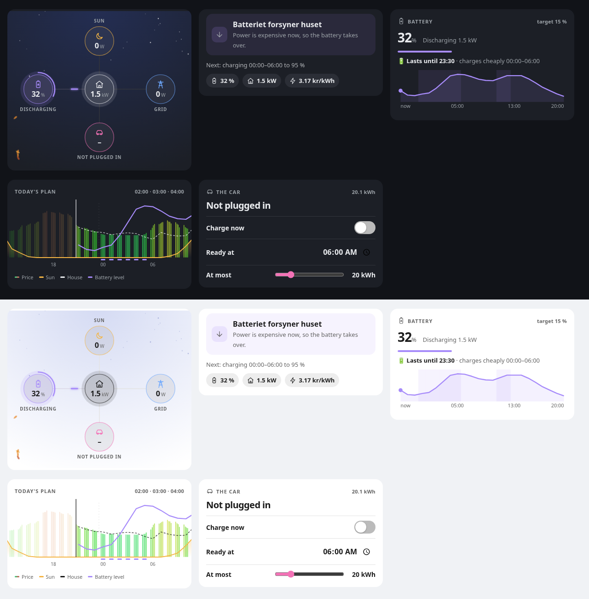

# Energipilot – companion integration

Entities, buttons and the dashboard card for [Energy Pilot](https://github.com/Clahen86/Energy-pilot) in Home Assistant.

Energy Pilot itself runs as an add-on (or in Docker) and does all the thinking. This integration only brings it into
Home Assistant: sensors and buttons for automations, and the `energipilot-card` for your dashboards. Energy Pilot works
without it too.

## The card

Add it from the card picker – search for *Energipilot* – and pick a view:

| View | What it shows |
|---|---|
| **Everything** | All of it in one card |
| **Energy flow** | Sun, house, battery, grid and car live, with the sky outside |
| **Status** | What it does now and why, what comes next, battery, house and price – small, for a phone |
| **Battery** | Level, what it does, how long it lasts, and its level the next 24 hours |
| **Today's plan** | Prices, sun, house and the battery's level hour by hour |
| **The car** | Charging, ready time and limit – folded to one line when it isn't plugged in |
| **Savings** | Saved today, yesterday, this month, this year and in all |

It follows your Home Assistant theme and language, and it is updated with the Energy Pilot add-on.

## Entities

| | |
|---|---|
| **Savings** | Saved today, yesterday, this month, this year, in all · what the plan saves |
| **Battery** | Target · cost price · lasts until · next charge · next sale · health (what it holds against its label) |
| **Car** | Next charge · *Charge now* · ready at · at most (kWh) or charge to (%) · 100 % for next trip |
| **More cars** | Each extra charger: the same, named after it · *Car in charger* (which car is plugged in, when you have a list of cars) |
| **Price and forecast** | Price now · price level (cheap / normal / dear) · cheapest hour · house today · sun today and tomorrow |
| **Control** | Decision · style · battery and car shadow/control · battery minimum · *Everything back to shadow* |
| **Problem** | On when something needs a look – a warning in Energy Pilot's own check, or Home Assistant not answering |

## Install

1. Open the **Marketplace** (HACS) in Home Assistant.
2. ⋮ → **Custom repositories**: paste `https://github.com/Clahen86/energy-pilot-companion`, type **Integration**.
3. Find **Energipilot**, choose **Download** and restart Home Assistant.
4. "Energipilot found" shows under **Settings → Devices & services**. With the add-on it's found by itself; in Docker,
   give the address, e.g. `http://ep:<password>@<host>:8099`.

Already have it from the add-on? Install it from HACS the same way – your entities, automations and card keep working.
The card is then served by the integration, and the add-on no longer needs access to Home Assistant's folder.
